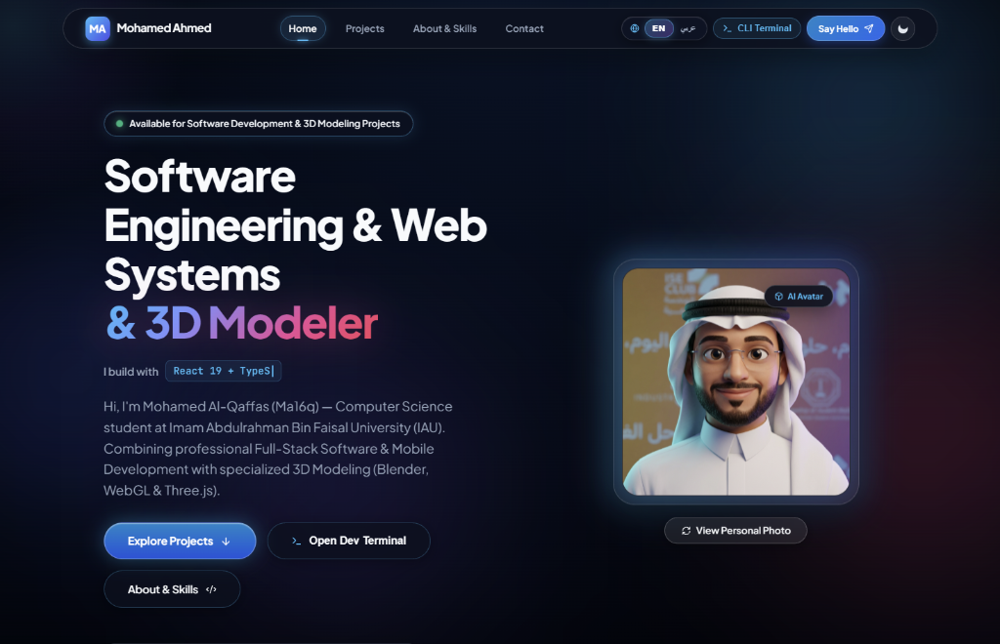
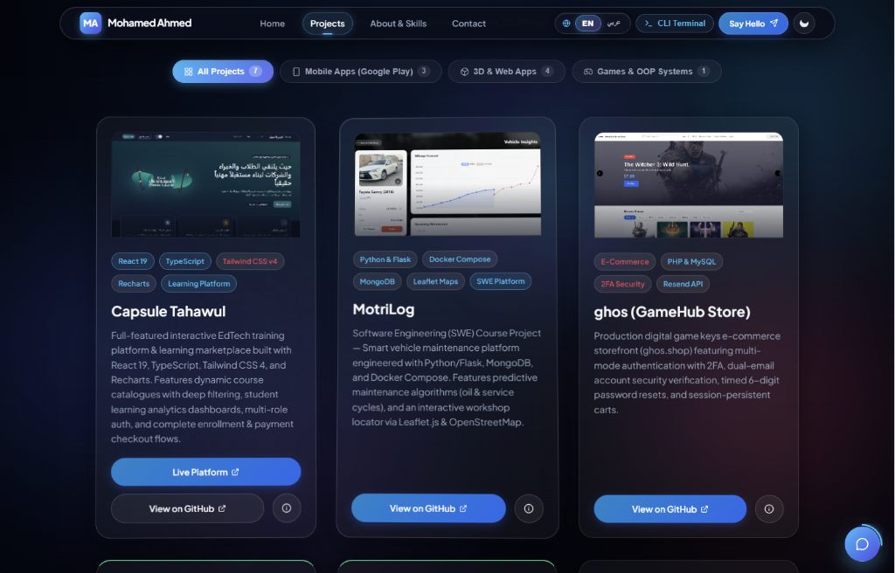
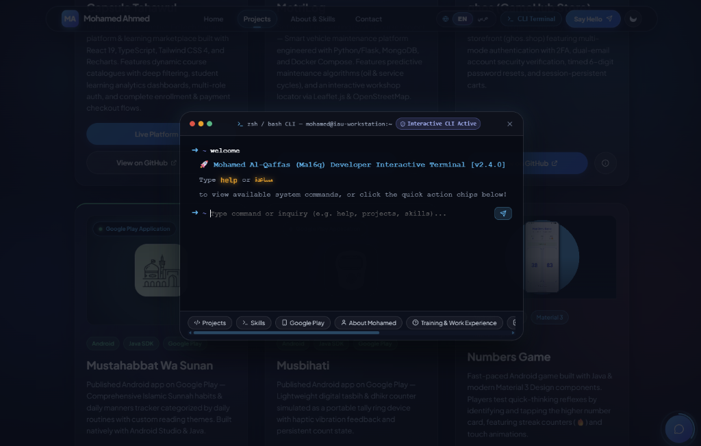
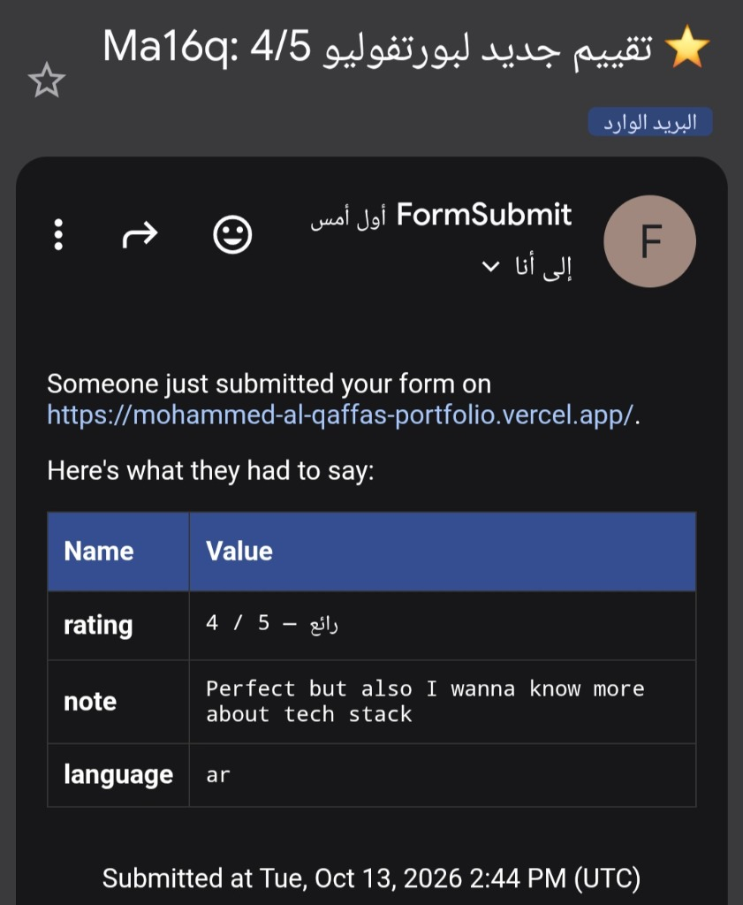

# 🚀 Mohamed Al-Qaffas (Ma16q) — Interactive 3D & Modern Engineering Portfolio

<div align="center">

[](https://mohammed-al-qaffas-portfolio.vercel.app)
[](https://github.com/Ma16q)
[](https://www.linkedin.com/in/ma16q/)
[](https://play.google.com/store/apps/details?id=com.mustahabbat.sunan)
[](https://www.iau.edu.sa)

<br/>

**Computer Science Student at Imam Abdulrahman Bin Faisal University (IAU) • Software Engineer • 3D Modeler**

*Eastern Province, Saudi Arabia* 🇸🇦

</div>

---

## 🌟 Overview

A state-of-the-art, high-performance web engineering portfolio built with **React 19**, **TypeScript**, **Tailwind CSS v4**, **Motion**, and pure **Vanilla CSS Glassmorphism**. Designed to showcase authentic native Android applications on Google Play, EdTech training platforms (Capsule Tahawul), SWE platforms (MotriLog), production e-commerce (ghos), and an embedded interactive CLI developer terminal with real-time feedback and instant email notification pipelines.

---

## 📸 Visual Showcase & Screenshots

<div align="center">

### 1. Hero Showcase & Interactive 3D Avatar


<br/>

### 2. Engineering Projects Showcase (Capsule Tahawul, MotriLog & ghos)


<br/>

### 3. Interactive Developer CLI Terminal (Built-in Assistant)


<br/>

### 4. Live Rating Dock & Instant Email Notification Delivery Proof


</div>

---

## 🛠️ Tech Stack & Engineering Tools

### 🌐 Frontend & WebGL
[](https://react.dev)
[](https://www.typescriptlang.org)
[](https://vitejs.dev)
[](https://threejs.org)
[](https://motion.dev)
[](https://developer.mozilla.org/en-US/docs/Web/HTML)
[](https://developer.mozilla.org/en-US/docs/Web/CSS)

### 📱 Mobile Engineering
[](https://developer.android.com)
[](https://www.oracle.com/java/)
[](https://m3.material.io)
[](https://developer.android.com/studio)
[](https://flutter.dev)
[](https://dart.dev)

### ⚙️ Backend, Cloud & Databases
[](https://www.python.org)
[](https://flask.palletsprojects.com)
[](https://www.docker.com)
[](https://www.mongodb.com)
[](https://www.php.net)
[](https://www.mysql.com)
[](https://play.google.com/store/apps/developer?id=Ma16q)
[](https://vercel.com)

### 🎨 3D Modeling & Design
[](https://www.blender.org)
[](https://www.khronos.org/webgl/)

---

## 📂 Featured Engineering Projects

| Project | Category | Tech Stack | Highlights & Features | Links |
| :--- | :---: | :--- | :--- | :---: |
| **MotriLog** | Web / 3D | Python, Flask, MongoDB, Docker Compose, Leaflet.js, Three.js | Software Engineering (SWE) course project. Smart maintenance tracker with predictive service algorithms (oil & maintenance cycles), interactive nearby workshop map via Leaflet & OpenStreetMap, and scroll-reactive 3D telemetry twin. | [Repo](https://github.com/Ma16q/MotriLog) |
| **ghos (GameHub Store)** | E-Commerce | PHP, MySQL, JavaScript, CSS3, Resend API, 2FA Engine | Live digital game keys storefront (ghos.shop). Two-factor email authentication (2FA), dual-email account security verification, timed 6-digit verification codes, and persistent cart synchronization. | [Store](https://ghos.shop) • [Repo](https://github.com/Ma16q/ghos) |
| **Mustahabbat Wa Sunan** | Mobile | Android Studio, Native Java, Material Design, Google Play | Published Android app on Google Play. Comprehensive Islamic Sunnah manners and habits tracker categorized by daily routines with custom reading themes and night mode. | [Google Play](https://play.google.com/store/apps/details?id=com.mustahabbat.sunan) |
| **Musbihati** | Mobile | Android Studio, Java SDK, Haptic Vibration, Google Play | Published Android app on Google Play. Lightweight portable tally ring simulation for daily tasbih with immediate haptic touch response and persistent SharedPreferences counters. | [Google Play](https://play.google.com/store/apps/details?id=com.musbihati) |
| **Numbers Game** | Mobile Game | Java SDK, Android Material 3, ConstraintLayout, Gradle | Native Android speed-math game (API 24 to 37). Features streak multiplier counter (🔥), local high score persistence, tactile card touch animations, and full Arabic/English localization. | [Repo](https://github.com/Ma16q/Numbers-Game) |
| **My First React** | Web | React, JavaScript (ES6+), CSS Modules, Hooks | Interactive React foundational laboratory exploring component hierarchy, custom hooks, and reactive UI architecture. | [Repo](https://github.com/Ma16q/My-First-React) |

---

## ⚡ Core Technical Features

1. **Lightweight Scroll-Reactive 3D Telemetry (MotriLog Twin)**:
   - Built with Three.js procedural PBR geometries (0 KB external download bloat, instant 60 FPS).
   - Seamless scroll integration: Camera smoothly glides between **Overview 360**, **Engine & Oil Diagnostics Wireframe**, **Tires & Brakes Telemetry**, and **Workshop Map Radar**.
2. **Interactive Developer CLI Terminal**:
   - Built-in terminal allowing visitors to execute commands (`projects`, `skills`, `play`, `bio`, `contact`, `car`, `theme`, `clear`).
   - High-contrast typography with colored syntax highlighting.
3. **Smooth Theme Switching (View Transition API)**:
   - Native circular reveal animation expanding from the toggle button when transitioning between Dark Mode and Light Mode.
4. **Authentic Google Play Showcase**:
   - Official 512×512 squircle icons and verified direct store links.
5. **Verified Real-World Email Delivery**:
   - Integrated with FormSubmit AJAX endpoint (`mohammed.alqaffas1@gmail.com`) with pre-filled career/interview template fallback.

---

## 💻 Local Development & Setup

### Prerequisites
- [Node.js](https://nodejs.org/) (v18 or newer)
- npm or yarn

### 1. Clone the repository
```bash
git clone https://github.com/Ma16q/Mohammed-Al-Qaffas-portfolio.git
cd Mohammed-Al-Qaffas-portfolio
```

### 2. Install dependencies
```bash
npm install
```

### 3. Run development server
```bash
npm run dev
```
The application will be live at `http://localhost:5173/`.

### 4. Build for production
```bash
npm run build
```
Runs TypeScript checks and generates the optimized production bundle in `dist/`.

---

## 👤 Author

**Mohamed Al-Qaffas (Ma16q / Mohamed Ahmed)**
- **University**: Imam Abdulrahman Bin Faisal University (IAU), Eastern Province, Saudi Arabia
- **LinkedIn**: [linkedin.com/in/ma16q](https://www.linkedin.com/in/ma16q/)
- **GitHub**: [@Ma16q](https://github.com/Ma16q)
- **Email**: [mohammed.alqaffas1@gmail.com](mailto:mohammed.alqaffas1@gmail.com)

---

<div align="center">
  <sub>© 2026 Mohamed Al-Qaffas. Designed & engineered with passion.</sub>
</div>
